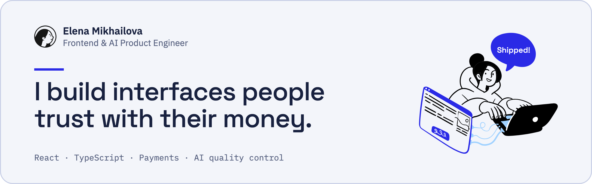

  
  
  
  

Checkout and subscription flows in React and TypeScript. AI content pipelines with automated quality control. And an accountant’s eye for the numbers: before tech, I spent 15 years as a chief accountant.

Based in Novi Sad, Serbia · Open to remote work and relocation

## Selected work

- **Automated quality control for an AI content pipeline** · HeroContent.ai · Dec 2025 – present 
  Vision QA audit, a read-only monitoring agent and rejection-reason analytics. Manual image review down to zero.
- **Payments and sign-in across a four-product platform** · All Funeral Services · Dec 2024 – Jul 2026 
  Stripe and Klarna checkout, config-driven SSO and checkout, real-time chat and Hebrew (RTL) localization.
- **Web and mobile apps for a six-clinic chain** · Missis Laser · May 2024 – Nov 2024 
  Partner program, e-contracts and online booking on the web and in React Native, plus amoCRM bots.

[More on the portfolio →](https://elena-mikhailova.vercel.app/#work)

## Skills

| Area | What I use |
| --- | --- |
| AI product engineering | Automated visual QA, error analysis, read-only tool-using agents, Claude and OpenAI APIs, Python |
| Product UI | TypeScript, React, Next.js, React Native, Redux Toolkit, Tailwind CSS / SCSS, WCAG, i18n & RTL |
| Payments, auth & real-time | Stripe, Klarna, config-driven checkout, Firebase Auth / SSO, Stream Chat / WebSocket |
| Quality & delivery | Jest, React Testing Library, Playwright, Storybook, GitHub Actions, Vite, Claude Code, Cursor |

  

## On GitHub

Most of my production work lives in private client repositories. Public here:

- [personal-website](https://github.com/ElenaMihailova/personal-website): the code behind my portfolio. React 19, strict TypeScript, SCSS with BEM and design tokens, no UI kit.
